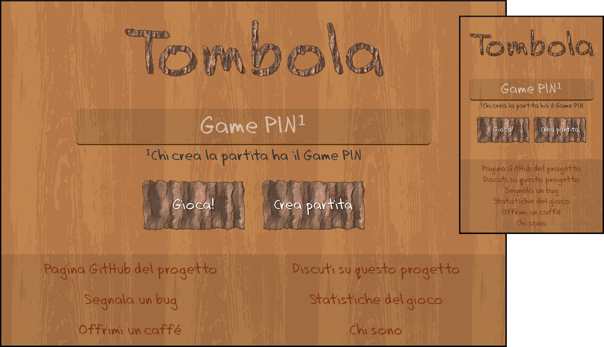

# Tombola [](https://www.paypal.com/paypalme/VincenzoPadula)
Il classico gioco natalizio online.


## Indice dei contenuti
  - [Come si gioca](#come-si-gioca)
  - [Contribuire](#contribuire)
  - [Server disponibili](#server-disponibili)
    - [Creare un nuovo server](#creare-un-nuovo-server)
  - [Altri dettagli](#altri-dettagli)

## Come si gioca
Questo gioco è pensato per essere giocato in compagnia di amici, parenti, ma anche compagni di banco o colleghi; non ha bisogno di registrazione.
* Una persona (_tombolone_, _tombolaro_ o _croupier_) si occupa di creare una nuova partita, ottenendo dal server un codice pin;
* Gli altri inseriranno quel codice pin dalla pagina principale e potranno scegliere sul momento un nome (unico per partita) e una cartella;
* La pagina del tombolone, pensata per essere proiettata su grande schermo (o comunque visibile a tutti) si aggiorna automaticamente con l'elenco dei partecipanti;
* Quando tutti i partecipanti (a discrezione del tombolone) si sono uniti alla partita, il gioco può iniziare.

## Contribuire
Chiunque può contribuire a questo progetto, in diversi modi:
* Traducendo il progetto in altre lingue;
* Scovando e segnalando/risolvendo [bug](https://github.com/padvincenzo/tombola/issues);
* Suggerendo nuove idee;
* Implementando nuove funzionalità.

Per qualunque dubbio o perplessità possiamo discuterne sulla [pagina apposita](https://github.com/padvincenzo/tombola/discussions).

## Server disponibili
[Gioca sul mio server](https://vincenzopadula.altervista.org/projects/tombola/)

_nessun altro server per ora_

### Creare un nuovo server
Se vuoi installare la tombola sul tuo server, devi:
1.  Scaricare tutti i file sul tuo server;
2.  Copiare ``.env.example`` in ``.env`` e inserire le credenziali del database e la password di amministratore;
3.  Aprire la pagina ``setup/`` del sito, accedere con la password di amministratore e premere *Installa*;
4.  Sei incoraggiato ad apportare modifiche e implementare nuove funzioni (nel rispetto della [licenza](https://github.com/padvincenzo/tombola/blob/main/LICENSE))
5.  Menziona la [pagina principale del progetto](https://github.com/padvincenzo/tombola) e, se vuoi, puoi proporre il tuo server, che aggiungerò alla tabella dei server disponibili.

Dopo ogni aggiornamento dei file, riapri ``setup/`` per applicare le eventuali modifiche al database.
Se la tombola era già installata con la vecchia pagina ``install.php``, ``setup/`` lo riconosce e applica solo gli aggiornamenti mancanti.

### Sviluppo locale con Docker
Con [Docker](https://www.docker.com/) puoi avviare la tombola sul tuo pc, con PHP 8.2 e MariaDB, senza installare altro:
```
docker compose up -d
```
*   Il gioco è su http://localhost:9090 (password di amministratore: ``admin``);
*   Adminer, per consultare il database, è su http://localhost:9091 (server ``db``, utente e password ``tombola``);
*   Il database viene installato e aggiornato a ogni avvio (con ``php setup/migrate.php``);
*   ``docker compose down -v`` ferma tutto e cancella il database.

Prima di proporre una modifica, formatta il codice (PHP secondo [PSR-12](https://www.php-fig.org/psr/psr-12/), JS e CSS con [Prettier](https://prettier.io/)):
```
docker compose run --rm php-tools php-cs-fixer fix
docker compose run --rm php-tools phpcs
docker compose run --rm prettier --write assets
```

## Altri dettagli
Trovi [qui](docs/README.md) ulteriori dettagli.
