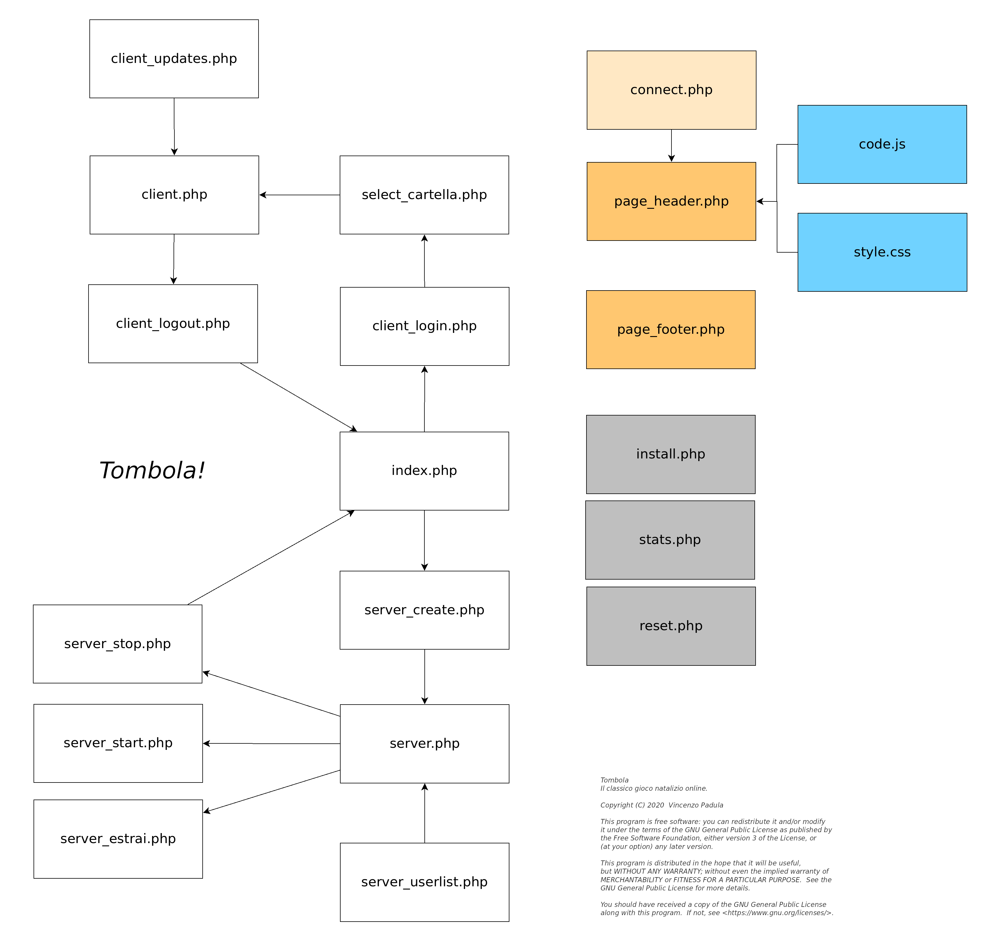
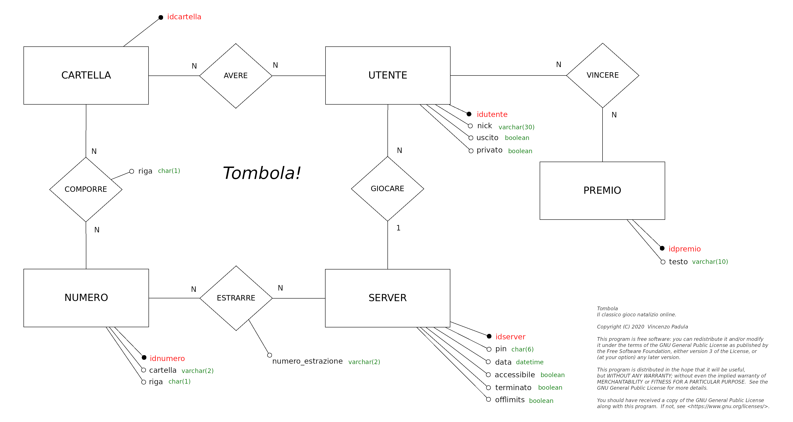

# Come funziona?

## Pagine

## Amministrazione

* ``setup/`` installa il database e applica gli aggiornamenti (password di amministratore);
* ``php setup/migrate.php`` fa lo stesso da riga di comando (``--stato`` mostra solo lo stato);
* ``setup/reset.php`` cancella tutte le partite.

### Modificare il database
Ogni modifica al database è una *migrazione*: un file ``setup/migrations/NNN_descrizione.sql``, applicato una sola volta, in ordine di numero.
Le migrazioni già applicate sono registrate nella tabella ``migrazioni``.

* Per una modifica crea un nuovo file con il numero successivo (es. ``002_aggiunge_ruolo_utente.sql``) e non modificare mai un file già pubblicato;
* Scrivi ``{prefix}`` al posto del prefisso delle tabelle (es. ``{prefix}utente``);
* MySQL non annulla le modifiche alla struttura (``create``, ``alter``) se un'istruzione successiva fallisce: preferisci una sola modifica per file, o istruzioni ripetibili come ``create table if not exists``.

## Database

